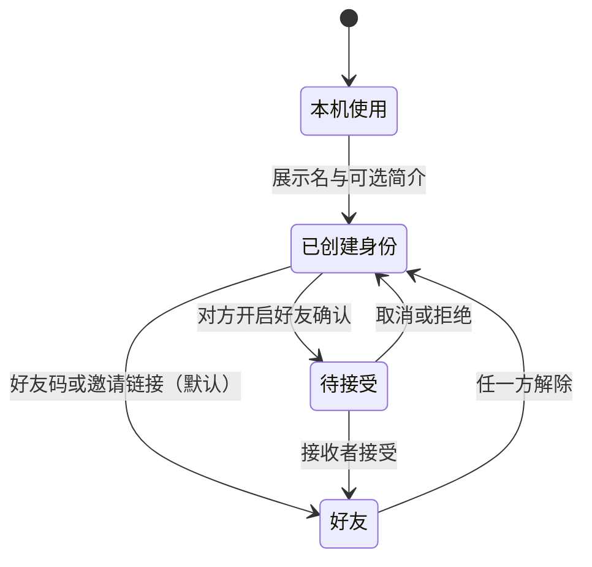

# 个人空间与好友：实现约定

所有 `/api/account`、`/api/friends`、`/api/people` 请求沿用现有 Bearer 随机凭证，响应 `Cache-Control: no-store`。公开标识和好友码均独立随机生成，不使用凭证散列前缀。旧的 `/api/records` 和 `/api/shares` 保持兼容。

## 接口

| 请求 | 数据和行为 |
| --- | --- |
| GET `/account` | 本人身份：`id, publicId, friendCode, nickname, bio, createdAt, portraitId, friendsVisible, requireFriendApproval, resultVisibility, hasPortraitSelection`。`resultVisibility` 默认 friends，独立于是否已有画像；`hasPortraitSelection` 区分首次选择与已删除的明确选择。 |
| POST `/account` | `{ nickname, bio?, resultVisibility? }`；创建或编辑身份，标识保持稳定。创建时可携带本机权限偏好；省略时保留原有权限。接口本身不上传记录，创建页随后按权限同步当前展示结果。 |
| PUT `/account/portrait` | `{ portraitId: string|null, friendsVisible?: boolean }`。选画像默认沿用统一权限；兼容旧客户端显式传 friendsVisible，并同步更新统一权限。仅允许本人未删除的云端快照；不生成公开链接。 |
| PUT `/account/privacy` | `{ requireFriendApproval?: boolean, resultVisibility?: 'private'|'friends' }`，至少提供一项。好友确认默认 false；测试结果默认 friends。public 暂不接受，UI 保留禁用选项。权限切换立即改变好友读取范围；好友确认只影响后续添加。 |
| POST `/account/friend-code` | 更换当前身份好友码，返回更新后的本人身份。旧码查找、旧邀请链接及已查找但尚未提交的旧码添加立即失效；已有好友与待处理申请保留。 |
| GET `/people/by-code/:code` | 仅返回 `publicId, nickname, bio, requireFriendApproval`，用于确认邀请。需已创建身份。 |
| GET `/friends` | `{ connections: [{ id, status, direction, person, createdAt, acceptedAt }] }`；person 仅含公开标识、名字、简介。 |
| POST `/friends` | `{ publicId, friendCode }`，写入时核对当前好友码及对方确认偏好。默认直接 accepted；对方开启确认时 pending。重复与交叉添加保持同一关系，accepted 不会降级。旧客户端仅传 publicId 时保留手动确认，公开标识本身不能授予直加权限。 |
| POST `/friends/:id/accept` | 仅申请接收者可接受；重复接受保持接受状态。被取消的申请返回 404。 |
| DELETE `/friends/:id` | 任一参与者取消、拒绝或解除。第三人和已不存在的关系返回 404；不改变公开链接。 |
| GET `/friends/:publicId/profile` | 查询时同时检查已接受关系和对方展示权限。返回 `{ person, portrait }`；portrait 使用原有公开字段白名单，不含答案、完整历史、分享 ID 或凭证。尚未展示时 portrait=null；不是好友时 403。 |

名字最长 24 字符、简介最长 80 字符。邀请链接 `#invite/:friendCode` 只携带可分享的好友码。首版提供好友码和邀请链接，不依赖二维码服务或第三方登录。

## 状态流

展示结果默认好友可见。创建身份、进入个人相关页面或完成新测试时，尚无明确云端选择且权限为 friends 的展示结果会自动同步；原始作答不进入好友接口。仅我可见时不触发默认同步。已有明确选择时，新测试不替换它，其他历史不批量上传。删除被选择的云端结果后，不自动回退或重新上传；本机副本仍可保留，重新选择是显式操作。

创建或恢复完成后返回原邀请、好友或设置上下文。`#me/profile`、`#me/history`、`#me/friends`、`#me/settings`、`#identity/:context`、`#friend/:publicId`、`#together/:publicId` 可刷新或直接进入。

设置页的「权限管理」集中提供测试结果三档选项、好友确认、好友码更换和已有分享链接管理。公开可见保留为「暂未开放」禁用选项。选画像不再附带可见性复选框，结果页和历史管理通过入口跳转到统一权限。已有单份分享链接在权限管理中展开管理，与个人空间范围独立生效。其他分组提供身份备份和记录存储。

对比双方当前主动展示且好友可见的画像，检查评分和题库版本。好友查看不依赖公开链接缓存；重新进入、刷新、窗口恢复焦点时重新核实。服务端无法收回已经被对方看过的内容。对比只显示维度，不将未授权的作答数量渲染成零。场景问题来自实际维度，不推断关系契合度。

云端写入按当前凭证串行，加入身份切换保护；排队前绑定身份，旧身份的请求不能落在新身份上。旧的账户刷新不能覆盖较新的资料保存。超时或断网显示错误，用户可重新读取核实；好友申请按用户对去重。

## 本地验证与发布边界

- `npm run lint`、`npm run build`、`npm test`。
- `npm run db:migrate:local` 仅迁移本机 D1。
- `npm run dev:full` 启动本地 Cloudflare；`npm run test:runtime` 用两个临时身份验证真实 D1、好友授权与页面静态渲染，脚本拒绝非本机地址。
- Vite 页面通过现有 `/api` 代理连接 `127.0.0.1:18788`。本机预览用 `LAN=0`。
- 上线前需先应用所需迁移到生产库，再部署依赖新结构的前端和 Functions。`0003_people.sql` 已于 2026-10-18 应用到生产 `blur` D1，并验证线上注册、账户读取、好友列表和展示设置。此次修复未重新部署代码。增量迁移兼容旧接口，但新接口不能运行在未迁移的库上；后续发布仍需检查远程待执行迁移，见 [部署说明](backend.md)。
- `0004_privacy.sql` 新增默认关闭的好友确认偏好，不改动已有关系、画像与分享；`0005_result_permissions.sql` 新增默认 friends 的独立测试结果权限，保留已有明确私密选择，并用触发器兼容旧服务写入。两项已于 2026-10-19 在本机及生产执行，确认远程无待执行迁移后部署前端与 Functions。
- 已完成默认可见、权限撤销与恢复、恢复身份、删除不回退、旧代码兼容的自动测试；实际生产 API 已验证权限写后读、好友读取范围、默认直加、确认偏好、旧码失效和分享兼容，临时身份及其数据已清理。部署及验证记录见 [backend.md](backend.md)。
- 已用本地浏览器检查桌面与手机布局、设置保存与刷新保留、从设置创建身份并返回、恢复密钥加载、更换好友码及完成反馈。手机视口未出现横向溢出。
