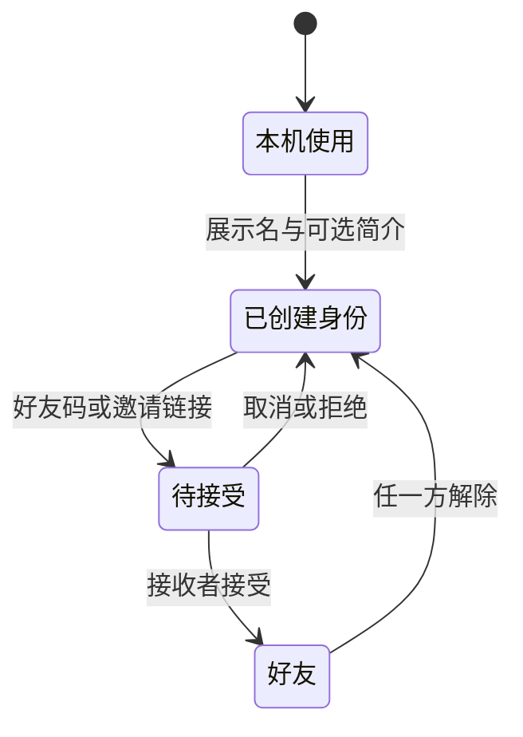

# 个人空间与好友：实现约定

所有 `/api/account`、`/api/friends`、`/api/people` 请求沿用现有 Bearer 随机凭证，响应 `Cache-Control: no-store`。公开标识和好友码均独立随机生成，不使用凭证散列前缀。旧的 `/api/records` 和 `/api/shares` 保持兼容。

## 接口

| 请求 | 数据和行为 |
| --- | --- |
| GET `/account` | 本人身份：`id, publicId, friendCode, nickname, bio, createdAt, portraitId, friendsVisible`。旧匿名云端身份可读取并补全公开标识。 |
| POST `/account` | `{ nickname, bio? }`；创建或编辑当前凭证对应的身份，标识保持稳定。兼容旧客户端省略 bio。显式创建页面要求非空展示名，接口继续允许旧客户端的空昵称。不会上传测试记录。 |
| PUT `/account/portrait` | `{ portraitId: string|null, friendsVisible: boolean }`。仅允许本人未删除的云端快照。`null` 清空选择；不生成公开链接。 |
| GET `/people/by-code/:code` | 仅返回 `publicId, nickname, bio`，用于确认邀请。需已创建身份。 |
| GET `/friends` | `{ connections: [{ id, status, direction, person, createdAt, acceptedAt }] }`；person 仅含公开标识、名字、简介。 |
| POST `/friends` | `{ publicId }`，返回关系 ID、状态和方向；无序用户对唯一。重复与交叉申请返回同一申请；交叉申请不自动接受。 |
| POST `/friends/:id/accept` | 仅申请接收者可接受；重复接受保持接受状态。被取消的申请返回 404。 |
| DELETE `/friends/:id` | 任一参与者取消、拒绝或解除。第三人和已不存在的关系返回 404；不改变公开链接。 |
| GET `/friends/:publicId/profile` | 查询时同时检查已接受关系和对方展示权限。返回 `{ person, portrait }`；portrait 使用原有公开字段白名单，不含答案、完整历史、分享 ID 或凭证。尚未展示时 portrait=null；不是好友时 403。 |

名字最长 24 字符、简介最长 80 字符。邀请链接 `#invite/:friendCode` 只携带可分享的好友码。首版提供好友码和邀请链接，不依赖二维码服务或第三方登录。

## 状态流

展示画像独立于关系：本机选择 → 明示同步此份记录 → 设置好友可见范围。新测试不替换展示画像。升级旧浏览器时一次性选取已有最新记录作为本机展示；之后保留明确指针。删除被选择的记录不自动换成另一份。删除云端画像后，好友端为空；该记录仍可作为本机记录保留。

创建或恢复完成后返回原邀请或好友上下文。`#me/profile`、`#me/history`、`#me/friends`、`#identity/:context`、`#friend/:publicId`、`#together/:publicId` 可刷新或直接进入。

对比双方当前主动展示且好友可见的画像，检查评分和题库版本。好友查看不依赖公开链接缓存；重新进入、刷新、窗口恢复焦点时重新核实。服务端无法收回已经被对方看过的内容。对比只显示维度，不将未授权的作答数量渲染成零。场景问题来自实际维度，不推断关系契合度。

云端写入按当前凭证串行，加入身份切换保护；排队前绑定身份，旧身份的请求不能落在新身份上。旧的账户刷新不能覆盖较新的资料保存。超时或断网显示错误，用户可重新读取核实；好友申请按用户对去重。

## 本地验证与发布边界

- `npm run lint`、`npm run build`、`npm test`。
- `npm run db:migrate:local` 仅迁移本机 D1。
- `npm run dev:full` 启动本地 Cloudflare；`npm run test:runtime` 用两个临时身份验证真实 D1、好友授权与页面静态渲染，脚本拒绝非本机地址。
- Vite 页面通过现有 `/api` 代理连接 `127.0.0.1:18788`。本机预览用 `LAN=0`。
- 上线前需先应用所需迁移到生产库，再部署依赖新结构的前端和 Functions。`0003_people.sql` 已于 2026-10-18 应用到生产 `blur` D1，并验证线上注册、账户读取、好友列表和展示设置。此次修复未重新部署代码。增量迁移兼容旧接口，但新接口不能运行在未迁移的库上；后续发布仍需检查远程待执行迁移，见 [部署说明](backend.md)。
- 尚需人工审看真实页面的手机排版、键盘操作和弹窗焦点。浏览器自动交互受本次工具访问策略限制，静态渲染检查不替代实际交互验收。
